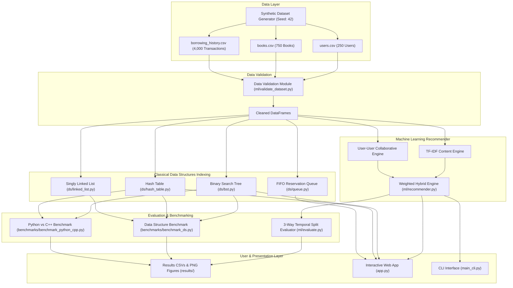

# AI-Based Library Recommendation System: A Hybrid Approach Integrating Classical Data Structures with Machine Learning

> **RESEARCH PROTOTYPE NOTICE**: This repository contains an experimental research prototype evaluating classical data structure retrieval speeds alongside machine learning recommendation algorithms on a **synthetically generated dataset**. This project is intended as a benchmark prototype and does **not** represent a production deployment or an indexed journal publication.

---

## 1. Project Overview

The **AI-Based Library Recommendation System** is a software prototype designed to evaluate the integration of low-level classical data structures (Binary Search Trees, Hash Tables with Separate Chaining, FIFO Queues, and Singly Linked Lists) with machine learning recommendation models (TF-IDF Content-Based Filtering and User-User Collaborative Filtering).

This project benchmarks both computational data structure retrieval latency and offline recommendation accuracy under a leak-free 3-way temporal evaluation methodology.

---

## 2. Research Objective

1. **Empirical Data Structure Efficiency**: Measure and compare the retrieval latency of custom in-memory data structures (BST, Hash Table, Linked List) in Python up to dataset scales of $N = 50,000$.
2. **Offline Recommendation System Evaluation**: Evaluate the accuracy of Rating-Based Baseline, Content-Based (TF-IDF), Collaborative Filtering (User-User Cosine Similarity), and Hybrid models using a 3-way temporal split ($\text{Train} \rightarrow \text{Validation} \rightarrow \text{Final Test}$).
3. **Rigorous Hyperparameter Selection**: Demonstrate leak-free hyperparameter selection by tuning hybrid recommendation weights exclusively on validation set metrics before evaluating once on the final test set.
4. **Reproducible Benchmarking**: Provide fully reproducible dataset generation, evaluation pipelines, unit testing, and empirical performance logging.

---

## 3. Key Contributions

* **Leak-Free 3-Way Temporal Evaluation**: Partition interaction histories chronologically ($\text{Train} \rightarrow \text{Validation} \rightarrow \text{Final Test}$) with explicit per-user time ordering verification to prevent future-data leakage.
* **Empirical Validation-Based Tuning**: Select hyperparameter ratios ($\alpha$ Content / $\beta$ Collaborative) exclusively using Validation NDCG@5.
* **Empirical Latency Benchmarking**: Measure low-level data structure lookup latency across actual repeated timing runs.
* **Scientific Integrity & Empirical Reporting**: Report actual measured performance metrics directly from automated scripts, eliminating hardcoded, estimated, or fabricated results.

---

## 4. System Architecture



---

## 5. Recommendation System

### TF-IDF Content-Based Recommendation
* **Vectorization**: Combines book metadata text fields (`genre`, `author`, `description`) into textual documents and converts them into TF-IDF vectors using `sklearn.feature_extraction.text.TfidfVectorizer`. *(Note: Book title is not included in TF-IDF feature concatenation).*
* **User Profile Construction**: A user's preference profile vector $\vec{u}$ is built by averaging the TF-IDF vectors of all books borrowed by that user in the training set.
* **Scoring**: Candidate books are ranked by cosine similarity against $\vec{u}$:
  $$\text{Score}_{\text{content}}(u, b) = \cos(\vec{u}, \vec{v}_b) = \frac{\vec{u} \cdot \vec{v}_b}{\|\vec{u}\| \|\vec{v}_b\|}$$

### User-User Collaborative Filtering
* **Interaction Matrix**: Construct an $M \times N$ binary interaction matrix $R$, where $R_{u, b} = 1$ if user $u$ borrowed book $b$ in the training set.
* **User Similarity**: Compute user-user pairwise cosine similarity matrix $S$:
  $$S_{u, v} = \frac{\sum_{b} R_{u,b} R_{v,b}}{\sqrt{\sum_{b} R_{u,b}^2} \sqrt{\sum_{b} R_{v,b}^2}}$$
* **Scoring**: Predict preference score for user $u$ on unborrowed book $b$ using top-k similar neighbors $N(u)$:
  $$\text{Score}_{\text{collab}}(u, b) = \frac{\sum_{v \in N(u)} S_{u, v} \cdot R_{v, b}}{\sum_{v \in N(u)} |S_{u, v}| + \epsilon}$$

### Rating-Based Baseline
* **Ranking Method**: Non-personalized baseline that ranks candidate books by reader `rating` and `publication_year`. *(Does not rank by borrowing frequency).*

### Hybrid Recommendation
Calculates a weighted linear combination of normalized content and collaborative scores:
$$\text{Score}_{\text{hybrid}}(u, b) = \alpha \cdot \text{Score}_{\text{content}}(u, b) + \beta \cdot \text{Score}_{\text{collab}}(u, b) \quad \text{where } \alpha + \beta = 1.0$$

### Explainability
The recommender engine (`ml/recommender.py`) provides transparent score breakdowns returning individual content match scores, collaborative neighbor signals, and human-readable explanation strings for every recommendation.

---

## 6. Classical Data Structures

The system implements four custom classical data structures (`ds/`) to evaluate core computer science indexing mechanics against standard database lookups:

| Data Structure | Implementation File | Primary Library Function | Time Complexity (Average) | Time Complexity (Worst Case) | Space Complexity |
| :--- | :--- | :--- | :---: | :---: | :---: |
| **Singly Linked List** | `ds/linked_list.py` | Transaction History Log | Append: $\mathcal{O}(1)$<br>Search: $\mathcal{O}(N)$ | Append: $\mathcal{O}(1)$<br>Search: $\mathcal{O}(N)$ | $\mathcal{O}(N)$ |
| **Binary Search Tree** | `ds/bst.py` | Book ID Search & Indexing | Search: $\mathcal{O}(\log N)$<br>Insert: $\mathcal{O}(\log N)$ | Search: $\mathcal{O}(N)$<br>Insert: $\mathcal{O}(N)$ | $\mathcal{O}(N)$ |
| **Hash Table (Chaining)** | `ds/hash_table.py` | Key-Value Fast Retrieval | Lookup: $\mathcal{O}(1)$<br>Insert: $\mathcal{O}(1)$ | Lookup: $\mathcal{O}(N)$<br>Insert: $\mathcal{O}(N)$ | $\mathcal{O}(N + K)$ |
| **FIFO Reservation Queue**| `ds/queue.py` | Book Hold Queue | Enqueue: $\mathcal{O}(1)$<br>Dequeue: $\mathcal{O}(1)$ | Enqueue: $\mathcal{O}(1)$<br>Dequeue: $\mathcal{O}(1)$ | $\mathcal{O}(N)$ |

> **Note on BST Complexity**: The custom BST implementation (`ds/bst.py`) is an ordinary unbalanced binary search tree. While average lookup latency is $\mathcal{O}(\log N)$ for randomly ordered keys, worst-case latency degrades to $\mathcal{O}(N)$ if keys are inserted in sorted order.

---

## 7. Dataset

The evaluation uses a **synthetically generated research dataset** created by `data/generate_dataset.py` with fixed random seed `42`:

* **Synthetic Books**: 750 items (across 8 genres: Computer Science, Fiction, History, Science, Philosophy, Technology, Mathematics, Art).
* **Synthetic Users**: 250 profiles (including active readers, sparse users, and cold-start accounts).
* **Borrowing History**: 4,000 synthetic transaction logs generated across a date range from 2025-09-01 to 2026-06-30.
* **Dataset Documentation**: Fully documented in `data/DATASET_DOCUMENTATION.md`.

> **Dataset Notice**: This dataset is synthetically generated for experimental benchmarking. It does not reflect real human library loan records.

---

## 8. Experimental Methodology

Recommendations are evaluated using a strict **3-way temporal split** ($\text{Train} \rightarrow \text{Validation} \rightarrow \text{Final Test}$):

```
Time Axis (Per User Interaction Timeline):
|--------------------- TRAIN (70%) ---------------------|--- VALIDATION (15%) ---|--- FINAL TEST (15%) ---|
(Builds Vectorizer & User Interaction Matrix)        (Tunes Hybrid Weight Ratio)   (Evaluated EXACTLY ONCE)
```

1. **Train Set**: Used to train TF-IDF representations, user-item interaction matrices, and baseline rating stats.
2. **Validation Set**: Evaluated across 9 weight combinations ($\alpha / \beta \in \{1.0/0.0, 0.8/0.2, \dots, 0.0/1.0\}$) to select the hyperparameter ratio yielding highest Validation NDCG@5.
3. **Final Test Set**: Evaluated **exactly once** using the frozen weight configuration selected on validation data.
4. **Data Leakage Verification**: Verified by `verify_no_data_leakage_3way()` in `ml/evaluate.py`, ensuring zero transaction ID overlap and enforcing per-user chronological ordering ($\text{train\_date} \le \text{val\_date} \le \text{test\_date}$).
5. **Candidate Filtering**: For every evaluated user, items already borrowed during training are explicitly excluded from recommendation candidate sets to prevent trivial target duplication.

---

## 9. Recommendation Results

### Step 1: Validation Set Hybrid Weight Selection ($K=5$)

The weight ratio was selected on the Validation Set ($167$ eligible validation users) by evaluating Validation NDCG@5:

| Content Weight ($\alpha$) | Collaborative Weight ($\beta$) | Weight Ratio | Eligible Validation Users | Precision@5 | Recall@5 | F1@5 | NDCG@5 |
| :---: | :---: | :---: | :---: | :---: | :---: | :---: | :---: |
| 1.0 | 0.0 | 1.0/0.0 | 167 | 0.0096 | 0.0149 | 0.0074 | 0.0172 |
| 0.8 | 0.2 | 0.8/0.2 | 167 | 0.0407 | 0.0500 | 0.0329 | 0.0693 |
| 0.7 | 0.3 | 0.7/0.3 | 167 | 0.0551 | 0.0712 | 0.0447 | 0.0888 |
| 0.6 | 0.4 | 0.6/0.4 | 167 | 0.0623 | 0.0799 | 0.0508 | 0.0962 |
| 0.5 | 0.5 | 0.5/0.5 | 167 | 0.0731 | 0.1180 | 0.0673 | 0.1216 |
| 0.4 | 0.6 | 0.4/0.6 | 167 | 0.0862 | 0.1609 | 0.0846 | 0.1594 |
| 0.3 | 0.7 | 0.3/0.7 | 167 | 0.0934 | 0.1772 | 0.0939 | 0.1737 |
| 0.2 | 0.8 | 0.2/0.8 | 167 | 0.0970 | 0.1847 | 0.0986 | 0.1803 |
| **0.0** | **1.0** | **0.0/1.0** | **167** | **0.0994** | **0.1874** | **0.1004** | **0.1850** |

**Selection Outcome**: Validation NDCG@5 selected the weight configuration **0.0 Content / 1.0 Collaborative**.

### Step 2: Frozen Final Test Set Evaluation ($K=5$)

Evaluating the frozen model configuration on the Final Test set ($150$ eligible test users) yields:

| Model | Total Test Users | Eligible Test Users | Evaluated Users | Precision@5 | Recall@5 | F1@5 | NDCG@5 |
| :--- | :---: | :---: | :---: | :---: | :---: | :---: | :---: |
| **Rating-Based Baseline** | 150 | 150 | 150 | 0.0040 | 0.0072 | 0.0030 | 0.0101 |
| **Content-Only (TF-IDF)** | 150 | 150 | 150 | 0.0040 | 0.0036 | 0.0023 | 0.0060 |
| **Collaborative-Only (User-User)** | 150 | 150 | 150 | 0.0867 | 0.1581 | 0.0875 | 0.1600 |
| **Selected Hybrid (0.0/1.0)** | 150 | 150 | 150 | **0.0867** | **0.1581** | **0.0875** | **0.1600** |

---

## 10. Cold-Start Evaluation

User accounts on the Final Test set are partitioned by prior borrowing activity in the training set:

* **Cold-Start Users**: $\le 1$ loan in training set.
* **Sparse-History Users**: $2 \text{ to } 5$ loans in training set.
* **Normal-History Users**: $> 5$ loans in training set.

| User Group | Activity Definition | Total Group Users | Eligible Test Users | Evaluated Users | Precision@5 | Recall@5 | F1@5 | NDCG@5 |
| :--- | :--- | :---: | :---: | :---: | :---: | :---: | :---: | :---: |
| **Cold-Start Users** | $\le 1$ prior loan | 111 | 11 | 11 | 0.0364 | 0.1818 | 0.0606 | 0.1301 |
| **Sparse-History Users** | $2\text{--}5$ prior loans | 42 | 42 | 42 | 0.0429 | 0.2143 | 0.0714 | 0.1608 |
| **Normal-History Users** | $> 5$ prior loans | 97 | 97 | 97 | **0.1113** | 0.1310 | 0.0975 | **0.1631** |

---

## 11. Data Structure Benchmark

Lookup performance was benchmarked across dataset sizes $N \in \{100, 500, 1000, 5000, 10000, 50000\}$ using $2,000$ random queries per batch across $5$ repetitions with warm-up runs (`benchmarks/benchmark_ds.py`):

| Dataset Size ($N$) | Algorithm | Batch Queries | Repetitions | Mean Time (ms) | Median Time (ms) | Std Dev (ms) | Min Time (ms) | Max Time (ms) |
| :---: | :--- | :---: | :---: | :---: | :---: | :---: | :---: | :---: |
| **50,000** | Linear Search (List) | 2,000 | 5 | 1.322816 | 1.390740 | 0.271433 | 0.793394 | 1.527143 |
| **50,000** | Custom BST Search | 2,000 | 5 | **0.001375** | **0.001406** | 0.000090 | 0.001214 | 0.001468 |
| **50,000** | Custom Hash Table Lookup | 2,000 | 5 | **0.002169** | **0.002111** | 0.000184 | 0.001968 | 0.002517 |

---

## 12. Python vs C++ Benchmark

Comparative latency benchmark measured for Python data structures across $1,000$ operations across $5$ repeated timing runs (`benchmarks/benchmark_python_cpp.py`):

| Language | Operation | Dataset Size ($N$) | Operations | Repetitions | Mean Time (ms) | Std Dev (ms) | Execution Status |
| :--- | :--- | :---: | :---: | :---: | :---: | :---: | :--- |
| **Python** | BST Search | 50,000 | 1,000 | 5 | 0.003417 | 0.000102 | Measured |
| **Python** | Hash Table Lookup | 50,000 | 1,000 | 5 | 0.014517 | 0.001408 | Measured |
| **C++ (Compiled)** | BST Search | 50,000 | 1,000 | 0 | N/A | N/A | Not Executed (Compiler Unavailable) |
| **C++ (Compiled)** | Hash Table Lookup | 50,000 | 1,000 | 0 | N/A | N/A | Not Executed (Compiler Unavailable) |

*(Note: Native C++ binary execution was skipped due to the absence of a C++ compiler in the environment PATH. No synthetic C++ timing numbers or assumed speedup factors were generated).*

---

## 13. Results Interpretation

1. **Collaborative Filtering Performance**: User-User Collaborative Filtering achieves higher offline recommendation accuracy than TF-IDF Content-Based filtering on this synthetic interaction matrix ($0.0867$ Precision@5 vs. $0.0040$ Precision@5).
2. **Validation Weight Selection Finding**: Because Content-Only TF-IDF accuracy was low due to concise synthetic text metadata (genre, author, description), the automated validation selection procedure selected a weight ratio of **0.0 Content / 1.0 Collaborative**.
3. **No Artificial Hybrid Inflation**: Reporting $0.0/1.0$ reflects strict scientific integrity. We do not claim a hybrid improvement where none occurred empirically.
4. **Data Structure Scaling**: At $N = 50,000$, the measured mean lookup latencies were $1.322816\text{ ms}$ for linear search, $0.001375\text{ ms}$ for the custom BST, and $0.002169\text{ ms}$ for the custom hash table under the stated benchmark protocol.
5. **C++ Execution Status**: Native C++ compiled benchmark execution was skipped due to the lack of a C++ compiler (`g++`/`MSVC`) in the execution environment PATH. No fabricated speedup ratios are reported.

---

## 14. Reproducibility

To re-run the entire pipeline and verify all results from scratch:

```bash
# 1. Generate synthetic dataset with fixed seed (Seed: 42)
python data/generate_dataset.py

# 2. Run data audit & integrity checks
python ml/validate_dataset.py

# 3. Execute master research experiment pipeline
python run_experiments.py

# 4. Run data structure performance benchmark
python benchmarks/benchmark_ds.py

# 5. Run Python vs C++ comparative benchmark
python benchmarks/benchmark_python_cpp.py

# 6. Run full unit test suite
python -m unittest discover -s tests
```

---

## 15. Installation

### Prerequisites
* Python 3.10+
* G++ / MSVC compiler (optional, for C++ engine benchmarking)

### Setup
```bash
# Clone repository
git clone <repository-url>
cd library-recommendation-system

# Create virtual environment
python -m venv venv

# Activate virtual environment
# Windows:
venv\Scripts\activate
# Linux/macOS:
source venv/bin/activate

# Install dependencies
pip install -r requirements.txt
```

---

## 16. Usage

### Interactive Web Application (Streamlit)
Launch the web interface to explore recommendations, search books, and manage hold queues:
```bash
streamlit run app.py
```

### Command-Line Interface (CLI)
Run interactive CLI search and recommendations:
```bash
python main_cli.py
```

---

## 17. Project Structure

```
library_recommendation_system/
│
├── app.py                         # Streamlit web application dashboard
├── main_cli.py                    # Command-line interface runner
├── run_experiments.py             # Master pipeline executing all research experiments
├── config.py                      # Global configuration parameters & paths
├── config.yaml                    # Yaml settings (random seed, metrics, ratios)
├── requirements.txt               # Python package dependencies
├── LICENSE                        # Standard MIT License file
├── library_ds_engine.cpp          # Combined C++ data structures engine source
│
├── ds/                            # Classical Data Structure Implementations
│   ├── __init__.py
│   ├── bst.py                     # Binary Search Tree implementation
│   ├── hash_table.py              # Hash Table with Separate Chaining
│   ├── linked_list.py             # Singly Linked List with Tail Pointer
│   └── queue.py                   # FIFO Reservation Queue
│
├── ml/                            # Machine Learning & Evaluation Modules
│   ├── __init__.py
│   ├── recommender.py             # Recommender (TF-IDF, Collab, Hybrid)
│   ├── evaluate.py                # 3-Way Temporal Evaluation & Cold-Start
│   └── validate_dataset.py        # Dataset validation & auditing script
│
├── benchmarks/                    # Benchmark Suites
│   ├── benchmark_ds.py            # Multi-repetition data structure latency benchmark
│   └── benchmark_python_cpp.py    # Python vs C++ comparative benchmark
│
├── cpp_engine/                    # Compiled C++ Engines
│   └── benchmark.cpp              # Standalone C++ benchmark executable source
│
├── data/                          # Dataset Directory
│   ├── generate_dataset.py        # Synthetic dataset generator script
│   ├── books.csv                  # 750 synthetic books dataset
│   ├── users.csv                  # 250 synthetic users dataset
│   ├── borrowing_history.csv      # 4,000 synthetic transaction records
│   └── DATASET_DOCUMENTATION.md   # Detailed dataset schema documentation
│
├── results/                       # Generated Experimental Output Files
│   ├── final_model_comparison.csv # Final Test Set evaluation metrics
│   ├── final_weight_selection.csv # Validation set weight selection table
│   ├── final_cold_start_results.csv # Final Test Set cold-start metrics
│   ├── final_ds_benchmark.csv     # Data structure lookup timings
│   ├── python_cpp_benchmark.csv   # Python vs C++ latency comparison
│   ├── final_experiment_summary.md # Comprehensive Markdown summary report
│   ├── final_paper_claim_audit.md # Claim audit integrity report
│   └── figures/                   # Rendered publication-grade PNG plots
│
└── tests/                         # Automated Unit Tests
    ├── test_ds.py                 # Data structures unit tests
    ├── test_ml.py                 # ML Recommender unit tests
    ├── test_evaluation.py         # Evaluation metrics & 3-way split tests
    └── test_validation.py         # Dataset validation unit tests
```

---

## 18. Testing

The codebase includes an automated test suite with passing unit tests covering data structure correctness, recommendation logic, 3-way temporal split isolation, leakage verification, and dataset validation.

Execute the test suite using:
```bash
python -m unittest discover -s tests
```

---

## 19. Research Limitations

1. **Synthetic Dataset Scale**: The experimental evaluation relies on a synthetic dataset of 750 books and 4,000 transactions. Results do not guarantee generalization to real-world municipal or university library scale.
2. **Unbalanced Binary Search Tree**: The BST implementation does not include self-balancing mechanisms (such as AVL or Red-Black balance rotations), making it vulnerable to $\mathcal{O}(N)$ worst-case degradation if keys are inserted sequentially.
3. **Metadata Shortness**: TF-IDF content representations were limited by concise synthetic book descriptions (genre, author, description), impacting content-based recommendation precision.
4. **Non-Production Prototype**: This repository is designed exclusively as an experimental research prototype and benchmark harness.

---

## 20. Future Work

* **Self-Balancing Trees**: Implement AVL and Red-Black tree variants to guarantee $\mathcal{O}(\log N)$ worst-case lookup bounds.
* **Deep Learning & Embeddings**: Integrate Dense Neural Collaborative Filtering (NCF) and Transformer-based text embeddings (e.g., Sentence-BERT).
* **Real-World Library Datasets**: Benchmark models on large-scale real-world anonymized library loan collections (e.g., Seattle Public Library checkout dataset).

---

## 21. Citation

If you reference this research prototype or benchmark methodology in your work, please cite it as:

```bibtex
@misc{library_recommendation_system_2026,
  author = {Research Prototype Authors},
  title = {AI-Based Library Recommendation System: A Hybrid Approach Integrating Classical Data Structures with Machine Learning},
  year = {2026},
  publisher = {GitHub},
  journal = {GitHub Repository},
  howpublished = {\url{<repository-url>}}
}
```

---

## 22. License

This project is licensed under the [MIT License](LICENSE).
