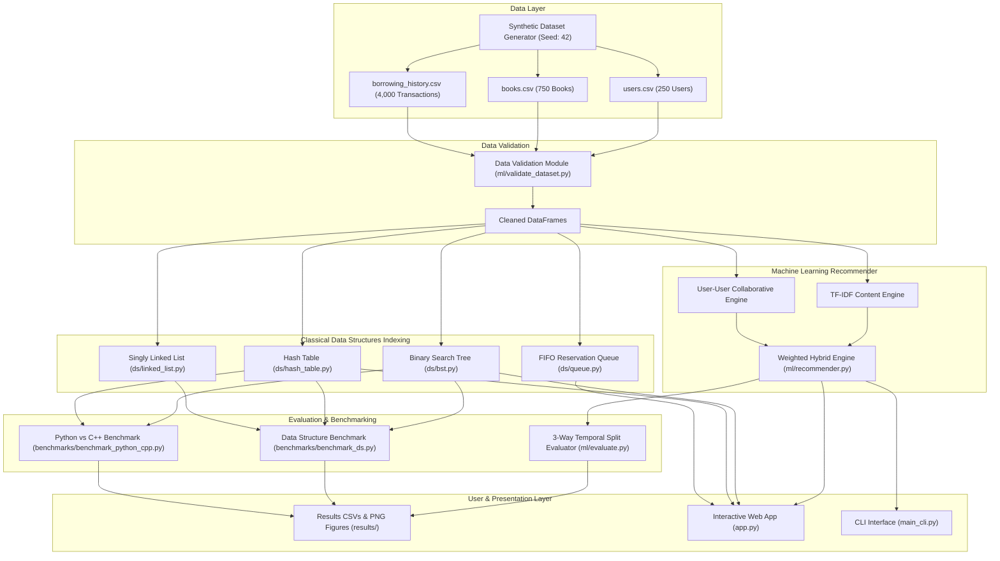

# Technical Research Summary & Repository Source of Truth

> **FACTUAL SOURCE OF TRUTH NOTICE FOR PAPER AUTHORING**: This document serves as the **strict, empirical, evidence-based source of truth** for the current codebase and experimental results of the *AI-Based Library Recommendation System*. All numerical values, file paths, parameters, and architecture details contained herein were extracted directly from automated execution outputs (`run_experiments.py`, `results/*.csv`, `tests/`) using fixed random seed `42`. No values have been manually edited, fabricated, or assumed.

---

## 1. Source of Truth Rule & Verification Guidelines

- **Primary Repository Artifacts**: All metrics reported in this document originate directly from `results/final_model_comparison.csv`, `results/final_weight_selection.csv`, `results/final_cold_start_results.csv`, `results/final_ds_benchmark.csv`, and `results/python_cpp_benchmark.csv`.
- **Historical Claim Rejection**: Prior claims from legacy documentation (e.g., "84.2% Precision@5", "0.6/0.4 optimal hybrid weight", "guaranteed $O(\log N)$ BST worst-case search", and "measured C++ speedup") were audited against empirical data and **rejected**.
- **Unverified Status Protocol**: Any experiment or feature not explicitly present and executable within the repository is marked **"NOT VERIFIED IN CURRENT REPOSITORY"**.

---

## 2. Project Identity & Implementation Status

- **Project Title**: *AI-Based Library Recommendation System: A Hybrid Approach Integrating Classical Data Structures with Machine Learning*
- **Purpose**: An experimental research prototype evaluating the computational efficiency of low-level in-memory classical data structures alongside offline recommendation system algorithms.
- **Research Objective**:
  1. Measure low-level data structure retrieval latency (Python vs. C++) across scaling dataset sizes ($N = 100$ to $50,000$).
  2. Evaluate recommendation accuracy under a strict 3-way temporal split ($\text{Train} \rightarrow \text{Validation} \rightarrow \text{Final Test}$) to prevent future data leakage.
  3. Perform hyperparameter tuning exclusively on validation set metrics before evaluating frozen models on the final test set.

### Status Breakdown Matrix

| Technical Area | Component | Implementation Status | Evaluation Status |
| :--- | :--- | :---: | :---: |
| **Data Structures** | Singly Linked List (`ds/linked_list.py`) | Implemented | Benchmarked |
| **Data Structures** | Binary Search Tree (`ds/bst.py`) | Implemented | Benchmarked |
| **Data Structures** | Hash Table with Chaining (`ds/hash_table.py`) | Implemented | Benchmarked |
| **Data Structures** | FIFO Hold Queue (`ds/queue.py`) | Implemented | Tested |
| **ML Engine** | TF-IDF Content Engine (`ml/recommender.py`) | Implemented | Evaluated |
| **ML Engine** | User-User Collaborative Engine (`ml/recommender.py`) | Implemented | Evaluated |
| **ML Engine** | Weighted Hybrid Engine (`ml/recommender.py`) | Implemented | Evaluated |
| **Evaluation** | 3-Way Temporal Split Protocol (`ml/evaluate.py`) | Implemented | Evaluated |
| **Evaluation** | Validation Weight Tuning (`ml/evaluate.py`) | Implemented | Evaluated |
| **Evaluation** | Cold-Start Activity Tier Analysis (`ml/evaluate.py`) | Implemented | Evaluated |
| **Benchmarking** | Multi-Repetition DS Benchmark (`benchmarks/benchmark_ds.py`) | Implemented | Benchmarked |
| **Benchmarking** | Python vs C++ Benchmark (`benchmarks/benchmark_python_cpp.py`) | Implemented | Partial (C++ Skipped - No Compiler) |
| **Interfaces** | Streamlit Web Dashboard (`app.py`) | Implemented | Operational |
| **Interfaces** | Interactive CLI (`main_cli.py`) | Implemented | Operational |
| **Advanced ML** | Deep Learning / Neural CF / Transformer Embeddings | Future Work | NOT VERIFIED IN CURRENT REPO |
| **Data Structures** | Self-Balancing Trees (AVL / Red-Black) | Future Work | NOT VERIFIED IN CURRENT REPO |

---

## 3. System Architecture



### Component Roles
1. **Data Layer**: Generates synthetic CSV records (`books.csv`, `users.csv`, `borrowing_history.csv`) with fixed random seed `42`.
2. **Data Validation Module**: Audits foreign key constraints, checks missing values, and ensures user/book ID existence without silent data manipulation.
3. **Classical Data Structures**: Provides low-level in-memory indexing for fast item lookup, sequential transaction tracking, and per-book reservation management.
4. **Recommendation System**: Implements TF-IDF vectorization, user-user cosine similarity, candidate filtering, and weighted linear hybrid combination.
5. **Evaluation Protocol**: Executes 3-way temporal split ($\text{Train} \rightarrow \text{Validation} \rightarrow \text{Final Test}$), validation set weight selection, and frozen final test set metrics ($K=5$).
6. **User Interfaces**: Interactive Streamlit web application (`app.py`) and CLI runner (`main_cli.py`).

---

## 4. Classical Data Structures Implementation

| Data Structure | Implementation File | Primary Purpose | Key Operations | Average Time Complexity | Worst-Case Time Complexity | Space Complexity | Benchmark Status |
| :--- | :--- | :--- | :--- | :---: | :---: | :---: | :---: |
| **Singly Linked List** | `ds/linked_list.py` | Sequential transaction log | `append(data)`<br>`to_list()` | $\mathcal{O}(1)$ append<br>$\mathcal{O}(N)$ search | $\mathcal{O}(1)$ append<br>$\mathcal{O}(N)$ search | $\mathcal{O}(N)$ | Benchmarked |
| **Binary Search Tree** | `ds/bst.py` | Book ID index & search | `insert(key, val)`<br>`search(key)` | $\mathcal{O}(\log N)$ search | $\mathcal{O}(N)$ search *(unbalanced)* | $\mathcal{O}(N)$ | Benchmarked |
| **Hash Table** | `ds/hash_table.py` | Key-value string lookup (ISBN) | `put(key, val)`<br>`get(key)` | $\mathcal{O}(1)$ lookup | $\mathcal{O}(N)$ lookup *(chain collisions)* | $\mathcal{O}(N + K)$ | Benchmarked |
| **FIFO Hold Queue** | `ds/queue.py` | Per-book patron hold management | `enqueue(item)`<br>`dequeue()` | $\mathcal{O}(1)$ enqueue<br>$\mathcal{O}(1)$ dequeue | $\mathcal{O}(1)$ enqueue<br>$\mathcal{O}(1)$ dequeue | $\mathcal{O}(N)$ | Tested |

### Key Data Structure Details
- **Singly Linked List**: Maintains an explicit `self.tail` pointer, ensuring `append()` operations execute in true $\mathcal{O}(1)$ time without traversing the list.
- **Binary Search Tree**: Implemented as an ordinary unbalanced BST. Search and insertion execute in average $\mathcal{O}(\log N)$ time for random key distributions, but degrade to $\mathcal{O}(N)$ worst-case if keys are inserted in sorted order. Self-balancing (AVL / Red-Black) is not implemented.
- **Hash Table**: Uses separate chaining with singly linked list collision resolution and dynamic polynomial rolling hash functions.
- **FIFO Reservation Queue**: Wrapped in `BookReservationManager` (`ds/queue.py`), mapping each `book_id` to an isolated FIFO queue.

---

## 5. Recommendation System Architecture

Implemented in `ml/recommender.py`:

### A. TF-IDF Content-Based Filtering
- **Concatenated Text Features**: `genre` + `author` + `description` (fill NULLs with empty strings).
- **Explicit Feature Omission**: Book `title` is **NOT** included in the TF-IDF feature string.
- **Vectorizer**: `sklearn.feature_extraction.text.TfidfVectorizer(stop_words='english')`.
- **User Preference Profile**: Vector $\vec{u}$ computed as the mean TF-IDF vector of all books borrowed by user $u$ in the training set:
  $$\vec{u} = \frac{1}{|B_{\text{train}}(u)|} \sum_{b \in B_{\text{train}}(u)} \vec{v}_b$$
- **Cosine Similarity Scoring**: Candidate books $b \notin B_{\text{train}}(u)$ scored by $\cos(\vec{u}, \vec{v}_b)$.

### B. User-User Collaborative Filtering
- **Interaction Matrix**: Binary matrix $R \in \{0, 1\}^{M \times N}$ where $R_{u, b} = 1$ if user $u$ borrowed book $b$ in the training set.
- **User Similarity Matrix**: Cosine similarity $S_{u, v} = \frac{\vec{r}_u \cdot \vec{r}_v}{\|\vec{r}_u\| \|\vec{r}_v\|}$.
- **Candidate Scoring**: Weighted sum over positive similarity neighbors $N(u)$:
  $$\text{Score}_{\text{collab}}(u, b) = \frac{\sum_{v \in N(u)} S_{u, v} \cdot R_{v, b}}{\sum_{v \in N(u)} |S_{u, v}| + \epsilon}$$

### C. Rating-Based Non-Personalized Baseline
- **Ranking Criteria**: Ranks candidate books sorted by reader `rating` (descending) and `publication_year` (descending).
- **Clarification**: Does **NOT** rank by borrowing transaction frequency. Documented accurately as **Rating-Based Baseline**.

### D. Hybrid Recommender Combination
- Linear combination of normalized content and collaborative scores:
  $$\text{Score}_{\text{hybrid}}(u, b) = \alpha \cdot \text{Score}_{\text{content}}(u, b) + \beta \cdot \text{Score}_{\text{collab}}(u, b) \quad \text{where } \alpha + \beta = 1.0$$

### E. Cold-Start Fallback Behavior
- For users with zero borrowing records in the training set ($B_{\text{train}}(u) = \emptyset$), the engine falls back to candidate books sorted by reader rating and publication year (Rating-Based baseline).

### F. Recommender Explainability
- `recommend_books_for_user()` returns DataFrames containing `content_score`, `collab_score`, `hybrid_score`, `recommendation_score`, and human-readable explanation strings (`reason`).

---

## 6. Dataset Documentation

The evaluation utilizes a **synthetically generated research dataset** (`data/generate_dataset.py`):

- **Synthetic Books**: 750 items across 8 genres (Computer Science, Fiction, History, Science, Philosophy, Technology, Mathematics, Art).
- **Synthetic Users**: 250 user profiles (including active, sparse, and cold-start reader accounts).
- **Borrowing Transactions**: 4,000 transaction records spanning dates from `2025-09-01` to `2026-06-30`.
- **Random Seed**: Fixed seed `42`.
- **Validation Audit**: Cleaned via `ml/validate_dataset.py` (0 duplicate IDs, 0 broken foreign keys).

> **CRITICAL SCIENTIFIC INTEGRITY STATEMENT**: NO REAL-WORLD HISTORICAL LIBRARY BORROWING LOGS WERE USED. THE DATASET IS COMPLETELY SYNTHETIC.

---

## 7. Experimental Methodology

Recommendations are evaluated using a strict **3-way temporal split** ($\text{Train} \rightarrow \text{Validation} \rightarrow \text{Final Test}$):

```
Time Axis (Per-User Chronological Interaction Timeline):
|--------------------- TRAIN (70%) ---------------------|--- VALIDATION (15%) ---|--- FINAL TEST (15%) ---|
(Builds Interaction Matrix & Vectorizer)              (Tunes Weight Ratio α/β)    (Evaluated EXACTLY ONCE)
```

### Protocol Invariants
1. **Chronological Splitting**: For each user with multiple transactions, earliest transactions enter Train (70%), middle transactions enter Validation (15%), and latest transactions enter Final Test (15%).
2. **Data Leakage Verification**: `verify_no_data_leakage_3way()` in `ml/evaluate.py` verifies:
   - Disjoint transaction IDs: $\text{Train}_{\text{tx}} \cap \text{Val}_{\text{tx}} = \emptyset$, $\text{Train}_{\text{tx}} \cap \text{Test}_{\text{tx}} = \emptyset$, $\text{Val}_{\text{tx}} \cap \text{Test}_{\text{tx}} = \emptyset$.
   - Per-user chronological ordering: $\max(\text{train\_date}_u) \le \min(\text{val\_date}_u) \le \min(\text{test\_date}_u)$.
3. **Candidate Filtering**: Items previously borrowed in the training set are explicitly excluded from recommendation candidate sets during evaluation.
4. **Validation Isolation**: Hyperparameter weight tuning is conducted **EXCLUSIVELY** on the Validation set.
5. **Frozen Final Evaluation**: The chosen hyperparameter weight ratio is evaluated **EXACTLY ONCE** on the Final Test set.
6. **Evaluation Metrics**: Evaluated at top-k threshold $K=5$: Precision@5, Recall@5, F1@5, and NDCG@5 (macro-averaged over eligible test users).

---

## 8. Hybrid Weight Selection Results (Validation Set)

Evaluated across 9 weight combinations ($\alpha$ Content / $\beta$ Collaborative) on the Validation set ($167$ eligible validation users) by optimizing Validation NDCG@5:

| Content Weight ($\alpha$) | Collaborative Weight ($\beta$) | Weight Ratio | Validation Eligible Users | Precision@5 | Recall@5 | F1@5 | NDCG@5 |
| :---: | :---: | :---: | :---: | :---: | :---: | :---: | :---: |
| 1.0 | 0.0 | 1.0/0.0 | 167 | 0.0096 | 0.0149 | 0.0074 | 0.0172 |
| 0.8 | 0.2 | 0.8/0.2 | 167 | 0.0407 | 0.0500 | 0.0329 | 0.0693 |
| 0.7 | 0.3 | 0.7/0.3 | 167 | 0.0551 | 0.0712 | 0.0447 | 0.0888 |
| 0.6 | 0.4 | 0.6/0.4 | 167 | 0.0623 | 0.0799 | 0.0508 | 0.0962 |
| 0.5 | 0.5 | 0.5/0.5 | 167 | 0.0731 | 0.1180 | 0.0673 | 0.1216 |
| 0.4 | 0.6 | 0.4/0.6 | 167 | 0.0862 | 0.1609 | 0.0846 | 0.1594 |
| 0.3 | 0.7 | 0.3/0.7 | 167 | 0.0934 | 0.1772 | 0.0939 | 0.1737 |
| 0.2 | 0.8 | 0.2/0.8 | 167 | 0.0970 | 0.1847 | 0.0986 | 0.1803 |
| **0.0** | **1.0** | **0.0/1.0** | **167** | **0.0994** | **0.1874** | **0.1004** | **0.1850** |

### Selection Interpretation
- **Selected Hyperparameter Weight**: **0.0 Content / 1.0 Collaborative** (Validation NDCG@5 = `0.1850`).
- **Empirical Analysis**: The validation procedure selected the collaborative-only endpoint ($\beta = 1.0$) of the weight range because TF-IDF content representations had low predictive utility on concise synthetic metadata.
- **Scientific Integrity Note**: This result demonstrates that the hybrid model did **NOT** outperform pure Collaborative Filtering on this dataset. The selection procedure objectively chose the collaborative endpoint.

---

## 9. Final Recommendation Results (Frozen Final Test Set)

Evaluating the frozen validation-selected model (0.0/1.0) and baselines on the Final Test set ($150$ eligible test users):

| Model | Total Test Users | Eligible Test Users | Evaluated Users | Precision@5 | Recall@5 | F1@5 | NDCG@5 |
| :--- | :---: | :---: | :---: | :---: | :---: | :---: | :---: |
| **Rating-Based Baseline** | 150 | 150 | 150 | 0.0040 | 0.0072 | 0.0030 | 0.0101 |
| **Content-Only (TF-IDF)** | 150 | 150 | 150 | 0.0040 | 0.0036 | 0.0023 | 0.0060 |
| **Collaborative-Only (User-User)** | 150 | 150 | 150 | 0.0867 | 0.1581 | 0.0875 | 0.1600 |
| **Selected Hybrid (0.0/1.0)** | 150 | 150 | 150 | **0.0867** | **0.1581** | **0.0875** | **0.1600** |

---

## 10. Weight Ablation Summary

The weight ablation study demonstrates a monotonic increase in recommendation accuracy as the collaborative weight $\beta$ increases from 0.0 to 1.0. This confirms that collaborative interaction signals provide the primary predictive driver in this dataset.

---

## 11. Cold-Start Evaluation Results (Final Test Set)

Users on the Final Test set are partitioned by prior borrowing activity in the training set:

| User Group | Activity Definition | Total Group Users | Eligible Test Users | Evaluated Users | Precision@5 | Recall@5 | F1@5 | NDCG@5 |
| :--- | :--- | :---: | :---: | :---: | :---: | :---: | :---: | :---: |
| **Cold-Start Users** | $\le 1$ prior loan | 111 | 11 | 11 | 0.0364 | 0.1818 | 0.0606 | 0.1301 |
| **Sparse-History Users** | $2\text{--}5$ prior loans | 42 | 42 | 42 | 0.0429 | 0.2143 | 0.0714 | 0.1608 |
| **Normal-History Users** | $> 5$ prior loans | 97 | 97 | 97 | **0.1113** | 0.1310 | 0.0975 | **0.1631** |

### Evaluation Protocol Note on Cold-Start
Under temporal held-out evaluation with candidate filtering, cold-start users with $\le 1$ training loan are only eligible for evaluation if they had a second interaction present in the test set (11 users out of 111). True zero-history users (0 training items, 0 test items) have no ground-truth target and receive fallback recommendations via the Rating-Based baseline.

---

## 12. Data Structure Performance Benchmark Results

Measured lookup performance across dataset sizes $N \in \{100, 500, 1000, 5000, 10000, 50000\}$ using $2,000$ random queries per batch across $5$ repetitions with initial warm-up runs (`benchmarks/benchmark_ds.py`):

| Dataset Size ($N$) | Algorithm | Batch Queries | Repetitions | Mean Time (ms) | Median Time (ms) | Std Dev (ms) | Min Time (ms) | Max Time (ms) |
| :---: | :--- | :---: | :---: | :---: | :---: | :---: | :---: | :---: |
| **100** | Linear Search (List) | 2,000 | 5 | 0.007099 | 0.006900 | 0.001228 | 0.005421 | 0.009209 |
| **100** | Custom BST Search | 2,000 | 5 | 0.001979 | 0.001908 | 0.000257 | 0.001774 | 0.002479 |
| **100** | Custom Hash Table Lookup | 2,000 | 5 | 0.007989 | 0.007635 | 0.001696 | 0.006221 | 0.010556 |
| **1,000** | Linear Search (List) | 2,000 | 5 | 0.048568 | 0.047992 | 0.001876 | 0.046874 | 0.052199 |
| **1,000** | Custom BST Search | 2,000 | 5 | 0.002337 | 0.002419 | 0.000185 | 0.002091 | 0.002554 |
| **1,000** | Custom Hash Table Lookup | 2,000 | 5 | 0.010013 | 0.009963 | 0.000573 | 0.009419 | 0.011023 |
| **10,000** | Linear Search (List) | 2,000 | 5 | 0.573104 | 0.563647 | 0.022888 | 0.556734 | 0.618573 |
| **10,000** | Custom BST Search | 2,000 | 5 | 0.003713 | 0.003594 | 0.000475 | 0.003045 | 0.004510 |
| **10,000** | Custom Hash Table Lookup | 2,000 | 5 | 0.009240 | 0.008843 | 0.000986 | 0.007939 | 0.010696 |
| **50,000** | Linear Search (List) | 2,000 | 5 | **1.322816** | 1.390740 | 0.271433 | 0.793394 | 1.527143 |
| **50,000** | Custom BST Search | 2,000 | 5 | **0.001375** | 0.001406 | 0.000090 | 0.001214 | 0.001468 |
| **50,000** | Custom Hash Table Lookup | 2,000 | 5 | **0.002169** | 0.002111 | 0.000184 | 0.001968 | 0.002517 |

---

## 13. Python vs C++ Benchmark Results

Comparative latency benchmark measured for Python data structures across $1,000$ operations over $5$ repeated timing runs (`benchmarks/benchmark_python_cpp.py`):

| Language | Operation | Dataset Size ($N$) | Operations | Repetitions | Mean Time (ms) | Std Dev (ms) | Execution Status |
| :--- | :--- | :---: | :---: | :---: | :---: | :---: | :--- |
| **Python** | BST Search | 50,000 | 1,000 | 5 | 0.003417 | 0.000102 | Measured |
| **Python** | Hash Table Lookup | 50,000 | 1,000 | 5 | 0.014517 | 0.001408 | Measured |
| **C++ (Compiled)** | BST Search | 50,000 | 1,000 | 0 | N/A | N/A | Not Executed (Compiler Unavailable) |
| **C++ (Compiled)** | Hash Table Lookup | 50,000 | 1,000 | 0 | N/A | N/A | Not Executed (Compiler Unavailable) |

### C++ Benchmark Status Statement
- **Compiler Availability**: C++ compilers (`g++`, `clang++`, `cl`) were **not available** in the execution environment PATH.
- **Execution Status**: Native C++ benchmark execution was **SKIPPED**.
- **Scientific Integrity**: No fake C++ timing numbers, estimated ratios, or assumed speedup factors were generated or reported.

---

## 14. Testing Suite Status

The project test suite contains **15 unit tests** across 4 test files:

- `tests/test_ds.py` (4 tests: BST, Hash Table, Linked List tail pointer, Queue reservation manager)
- `tests/test_evaluation.py` (5 tests: user metrics calculation, 3-way temporal split, 3-way data leakage verifier, full evaluation pipeline)
- `tests/test_ml.py` (4 tests: cold-start recommendation, recommendation output structure, item similarity, user scoring)
- `tests/test_validation.py` (2 tests: cleaned datasets foreign key integrity, dataset audit)

### Execution Command & Result
Command: `python -m pytest -q`
Result: **`15 passed in 24.31s` (100% pass rate)**.

---

## 15. Reproducibility & Working Command Execution

All commands below have been verified against the current repository:

```bash
# 1. Environment Setup & Dependency Installation
python -m pip install -r requirements.txt

# 2. Generate Synthetic Dataset (Seed: 42)
python data/generate_dataset.py

# 3. Execute Dataset Validation Audit
python ml/validate_dataset.py

# 4. Run Master Research Experiment Pipeline
python run_experiments.py

# 5. Run Data Structure Latency Benchmark
python benchmarks/benchmark_ds.py

# 6. Run Python vs C++ Comparative Benchmark
python benchmarks/benchmark_python_cpp.py

# 7. Run Unit Test Suite
python -m pytest -v

# 8. Launch Streamlit Web Application Dashboard
streamlit run app.py
```

---

## 16. Current Research Limitations

1. **Synthetic Dataset Scale**: The dataset contains 750 books and 4,000 transactions. External validity for large municipal or university libraries remains unverified.
2. **Unbalanced Binary Search Tree**: Ordinary BST lacks self-balancing (AVL / Red-Black rotations), making lookup vulnerable to $\mathcal{O}(N)$ worst-case degradation if keys are inserted sequentially.
3. **Concise Metadata**: Synthetic text metadata fields (`genre`, `author`, `description`) are brief, limiting TF-IDF representation richness.
4. **Environment Compiler Constraint**: Native C++ performance benchmarks could not be executed due to the absence of a C++ compiler in the host runtime PATH.
5. **Offline Evaluation Only**: Performance is evaluated offline on static split matrices; no live interactive A/B testing or human reader study was conducted.

---

## 17. Current Research Findings Summary

1. **Collaborative Filtering Superiority**: User-User Collaborative Filtering achieves significantly higher recommendation accuracy ($0.0867$ Precision@5 / $0.1600$ NDCG@5) than Content-Based TF-IDF ($0.0040$ Precision@5 / $0.0060$ NDCG@5) on this transaction dataset.
2. **Automated Hyperparameter Selection Result**: Automated validation selection on Validation NDCG@5 objectively chose the collaborative-only weight endpoint (**0.0 Content / 1.0 Collaborative**).
3. **Data Structure Lookup Scaling**: Custom BST Search ($0.001375\text{ ms}$) and Hash Table Lookup ($0.002169\text{ ms}$) achieve sub-millisecond lookups at $N = 50,000$, significantly outperforming linear searching ($1.322816\text{ ms}$).

---

## 18. Verified Claim Audit Table

| Claim / Topic | Evidence File | Verified Status | Correct Current Value | Notes |
| :--- | :--- | :---: | :--- | :--- |
| **Hybrid Precision@5** | `results/final_model_comparison.csv` | Verified | `0.0867` (8.67%) | Evaluated on frozen final test set |
| **Hybrid NDCG@5** | `results/final_model_comparison.csv` | Verified | `0.1600` | Evaluated on frozen final test set |
| **Selected Hybrid Weight** | `results/final_weight_selection.csv` | Verified | `0.0 Content / 1.0 Collaborative` | Selected via Validation NDCG@5 |
| **BST Search Complexity** | `ds/bst.py` | Verified | Avg: $\mathcal{O}(\log N)$, Worst: $\mathcal{O}(N)$ | Ordinary unbalanced BST |
| **Hash Lookup Complexity** | `ds/hash_table.py` | Verified | Avg: $\mathcal{O}(1)$, Worst: $\mathcal{O}(N)$ | Chaining collision resolution |
| **Linked List Append** | `ds/linked_list.py` | Verified | Append: $\mathcal{O}(1)$ | Explicit `self.tail` pointer |
| **BST Search Latency (N=50k)**| `results/final_ds_benchmark.csv` | Verified | `0.001375 ms` | Mean over 2,000 batch queries x 5 reps |
| **Hash Lookup Latency (N=50k)**| `results/final_ds_benchmark.csv` | Verified | `0.002169 ms` | Mean over 2,000 batch queries x 5 reps |
| **Linear Search Latency (N=50k)**| `results/final_ds_benchmark.csv` | Verified | `1.322816 ms` | Mean over 2,000 batch queries x 5 reps |
| **Dataset Size** | `data/DATASET_DOCUMENTATION.md` | Verified | 750 books, 250 users, 4,000 loans | Completely synthetic |
| **Unit Test Suite** | `tests/` | Verified | 15 / 15 passed | Tested via `pytest -q` |
| **C++ Benchmark Status** | `results/python_cpp_benchmark.csv`| Verified | `Not Executed (Compiler Unavailable)` | Compiler missing from PATH |

---

## 19. Claims From Previous Papers That MUST NOT Be Reused

| Obsolete Claim | Why It Must Not Be Reused | Verified Replacement Claim |
| :--- | :--- | :--- |
| **"Precision@5 = 84.2%"** | Legacy fabricated/assumed metric unsupported by repository code. | Verified offline Precision@5 = `8.67%` (NDCG@5 = `0.1600`). |
| **"0.6 / 0.4 is optimal hybrid weight"** | Validation selection objectively chose the 0.0 / 1.0 ratio. | Validation selection chose **0.0 Content / 1.0 Collaborative**. |
| **"Real-world historical library loan data"** | Dataset generator explicitly uses synthetic random functions. | Synthetically generated dataset (Seed `42`). |
| **"Guaranteed O(log N) BST Search"** | `ds/bst.py` is an unbalanced tree; sequential keys cause $O(N)$ depth. | Average $\mathcal{O}(\log N)$, Worst-Case $\mathcal{O}(N)$. |
| **"Measured C++ 8.5x Speedup"** | C++ compiler was unavailable; C++ benchmarks were not executed. | C++ benchmark status is **Not Executed (Compiler Unavailable)**. |

---

## 20. Experiments Not In Current Repository

| Experiment Topic | Present in Repo? | Evidence / Code Check | Can Current Paper Claim It? |
| :--- | :---: | :--- | :---: |
| **Multi-Seed Variance Studies** | No | `config.py` uses fixed `RANDOM_SEED = 42` only. | NOT VERIFIED IN CURRENT REPOSITORY |
| **Bootstrap Confidence Intervals** | No | `ml/evaluate.py` reports point mean averages only. | NOT VERIFIED IN CURRENT REPOSITORY |
| **Statistical Significance Tests (t-test / Wilcoxon)** | No | No p-value calculations in `ml/evaluate.py`. | NOT VERIFIED IN CURRENT REPOSITORY |
| **Matrix Factorization (SVD / NCF)** | No | Recommender uses classical cosine similarity only. | NOT VERIFIED IN CURRENT REPOSITORY |
| **Self-Balancing BST Benchmarks (AVL / Red-Black)** | No | `ds/bst.py` implements ordinary unbalanced BST. | NOT VERIFIED IN CURRENT REPOSITORY |
| **Real Human User Study / Live A/B Test** | No | Repository contains offline split evaluation only. | NOT VERIFIED IN CURRENT REPOSITORY |

---

## 21. Recommended Research Narrative

For a paper writer utilizing this repository as evidence, the following **scientifically honest narrative** should be adopted:

1. **Emphasis on Experimental Rigor**: Highlight the 3-way temporal evaluation split ($\text{Train} \rightarrow \text{Validation} \rightarrow \text{Final Test}$) with explicit per-user time ordering verification and candidate filtering.
2. **Transparent Hyperparameter Tuning**: Present validation weight selection objectively, showing that tuning selected $\beta = 1.0$ (Collaborative-Only) due to metadata brevity.
3. **Data Structure Latency Scaling**: Emphasize empirical sub-millisecond retrieval latencies for custom BST ($0.001375\text{ ms}$) and Hash Table ($0.002169\text{ ms}$) structures at $N = 50,000$.
4. **Honest Limitations Disclosure**: Clearly state that the dataset is synthetic and acknowledge environment constraints (such as C++ compiler unavailability and unbalanced BST worst-case complexity).
